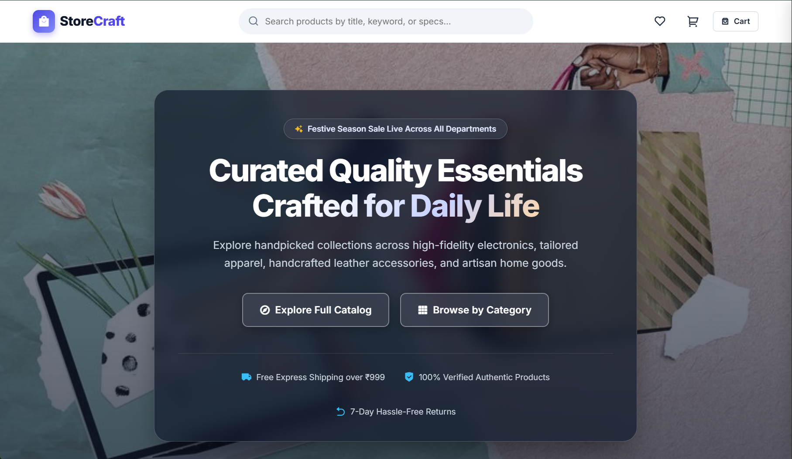
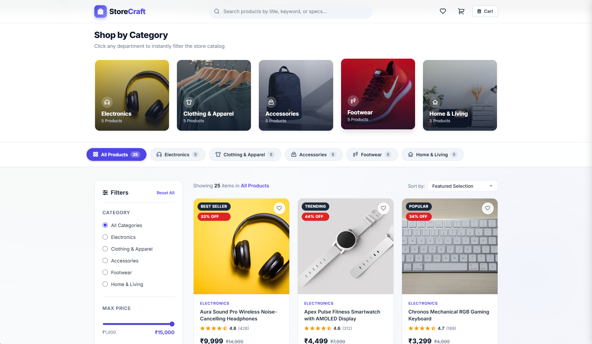

# StoreCraft — Modern Ecommerce Product Listing Platform

[](https://developer.mozilla.org/en-US/docs/Web/HTML)
[](https://developer.mozilla.org/en-US/docs/Web/CSS)
[](https://developer.mozilla.org/en-US/docs/Web/JavaScript)
[](https://opensource.org/licenses/MIT)
[](https://developer.mozilla.org/en-US/docs/Learn/CSS/CSS_layout/Responsive_Design)

A modern, responsive, and feature-rich Ecommerce Product Listing and Catalog website engineered with vanilla HTML5, CSS3 (CSS Variables, Grid, Flexbox, Glassmorphism), and modern ES6+ JavaScript modules.

---

## 📸 Visual Preview

The hero section features custom collage artwork with a glassmorphic container and twin frosted glass action buttons:




---

## 🌟 Key Features

### 1. Dual Category Navigation
- **Hero Category Cards**: Visual department cards on the storefront with high-resolution imagery, icon badges, and live product counts. Clicking any card automatically activates the category filter and smoothly scrolls to the catalog grid.
- **Sticky Category Filter Pills Bar**: Persistent category pills bar located right beneath the header for instant one-click switching across all departments:
  - 🛍️ *All Products* (25 items)
  - 🎧 *Electronics* (5 items)
  - 👕 *Clothing & Apparel* (5 items)
  - 👜 *Accessories* (5 items)
  - 👟 *Footwear* (5 items)
  - 🏡 *Home & Living* (5 items)

### 2. Real-Time Dynamic Filtering & Sorting
- **Live Search Bar**: Search instantaneously across product titles, descriptions, and categories with a 250ms debounce.
- **Price Range Slider**: Filter by maximum budget in Indian Rupees (`₹` INR) with real-time numeric readouts.
- **Customer Rating Filter**: Narrow products by minimum rating (4.8★ & above, 4.5★ & above, or all).
- **Deals & Stock Toggles**: Filter items that are currently *In Stock* or *On Sale / Discounted*.
- **Multi-criteria Sorting**:
  - Featured Selection
  - Price: Low to High
  - Price: High to Low
  - Highest Customer Rating
  - Biggest Discount %
  - Alphabetical (A - Z)
- **Active Filter Dismissible Chips**: Interactive chips displaying active filters that can be dismissed individually or cleared with a single "Clear All" button.

### 3. Product Cards & Quick View Modal
- High-resolution product images with hover zoom effect.
- Badges for *Sale*, *Best Seller*, *Trending*, *Top Rated*, and *Out of Stock*.
- Instant wishlist heart toggle with header counter integration.
- Star ratings with exact scores and customer review counts.
- **Quick View Modal**: Preview full specifications, multiple image angles, and add directly to cart without leaving the listing page.

### 4. Dedicated Product Details Page (`product-detail.html?id=...`)
- Dynamic parameter parsing for direct linking (`?id=elec-1`, `?id=cloth-1`, etc.).
- Interactive multi-angle image gallery with thumbnail switcher.
- Currency formatted in **Indian Rupee (₹ INR)** with exact savings calculation (*"You save ₹X (Y% off MRP)"*).
- Tabbed information architecture:
  - **Specifications Table** (Brand, Model, Dimensions, Materials, Warranty).
  - **Overview & Details** (Narrative highlights & feature checklist).
  - **Shipping & Return Policies** (Free delivery above ₹999, 7-day returns).
  - **Customer Reviews** with verified purchaser badges and star breakdowns.
- Dynamic **"You May Also Like"** related products grid for items in the same department.

### 5. Shopping Cart, Coupons & Simulated Checkout (`cart.html`)
- **Slide-over Cart Drawer**: Accessible from the header of any page for quick review and quantity changes.
- **Full Shopping Cart View**: Line items with thumbnails, unit prices, quantity steppers, item totals, and removal.
- **`localStorage` State Persistence**: Items and quantities persist across page reloads and browser sessions.
- **Free Shipping Threshold Bar**: Real-time progress notice (*"Add ₹X more for FREE Delivery!"*).
- **Promo Coupon Engine**:
  - `SAVE10` — 10% discount on order subtotal.
  - `FLAT500` — ₹500 discount on orders above ₹2,000.
  - `WELCOME` — 15% discount for first-time shoppers.
- **Simulated Checkout Flow**:
  - Shipping address form with validation.
  - Payment method selector (UPI, Credit/Debit Card, Net Banking, Cash on Delivery).
  - Loading animation and instant Order Confirmation with generated order reference ID (`#IND-XXXXXX`).

---

## 📁 Project Structure

```
Ecom product listing/
├── index.html               # Main storefront (Hero, Category Cards, Filter Sidebar, Product Grid, Quick View)
├── product-detail.html      # Dedicated product details view with gallery, specs, related items
├── cart.html                # Full shopping cart, coupon codes, and simulated checkout modal
├── PROJECT_REPORT.md        # Comprehensive 9-section academic and technical project report
├── README.md                # Project documentation and guide
├── .gitignore               # Git ignored patterns
├── css/
│   ├── style.css            # Design tokens, global resets, header, footer, toast, cart drawer
│   ├── products.css         # Category cards, sticky pills, filter sidebar, product cards grid
│   ├── detail.css           # Product detail page layout, gallery, tabs, related items
│   └── cart.css             # Cart table, order summary card, checkout modal
├── js/
│   ├── data.js              # Comprehensive catalog dataset (25 products across 5 categories in ₹ INR)
│   ├── cart.js              # State management: localStorage, INR currency formatter, cart drawer, toast
│   ├── app.js               # Main page controller: search, real-time filters, sorting, quick view
│   ├── detail.js            # Detail page controller: URL query parser, gallery switcher, tabs
│   └── cart-page.js         # Cart page controller: item rendering, coupons, simulated checkout
└── images/
    └── hero-bg.jpg          # Custom hero illustration backdrop
```

---

## 🚀 How to Run Locally

Since StoreCraft uses modern ES6 modules and standard browser web APIs, no build tools, Node.js, or package managers are required!

### Option 1: Using Python Built-in Web Server (Recommended)
1. Open terminal / command prompt in this project folder:
   ```bash
   python -m http.server 8000
   ```
2. Open your web browser and navigate to:
   ```
   http://localhost:8000
   ```

### Option 2: Using VS Code Live Server
1. Open the project folder in VS Code.
2. Right click on `index.html` and select **"Open with Live Server"**.

---

## 🌐 Deploying to GitHub Pages

Because this project is built entirely on vanilla HTML, CSS, and client-side JavaScript, you can host it for free on **GitHub Pages** in seconds:

1. Push this repository to GitHub.
2. Go to your repository on GitHub and click **Settings**.
3. Under the **Code and automation** section in the left sidebar, click **Pages**.
4. Under **Build and deployment > Source**, select **Deploy from a branch**.
5. Select branch `main` and folder `/ (root)`, then click **Save**.
6. Within 1-2 minutes, GitHub will publish your live website URL (e.g. `https://<your-username>.github.io/<repo-name>/`)!

---

## 🏷️ Test Promo Codes
During checkout on `cart.html`, try the following coupon codes:
- **`SAVE10`**: 10% discount on cart subtotal
- **`FLAT500`**: Flat ₹500 off (orders over ₹2,000)
- **`WELCOME`**: 15% discount for first-time customers

---

## 📄 License
This project is open source and available under the [MIT License](LICENSE).
